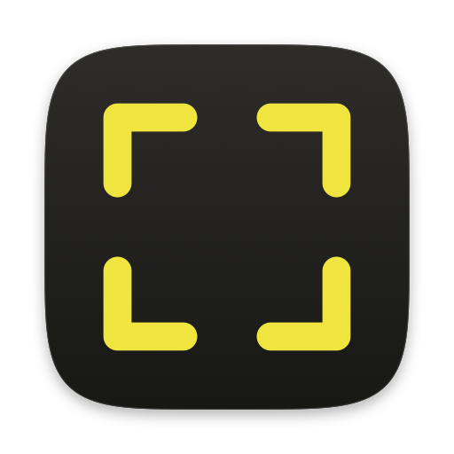
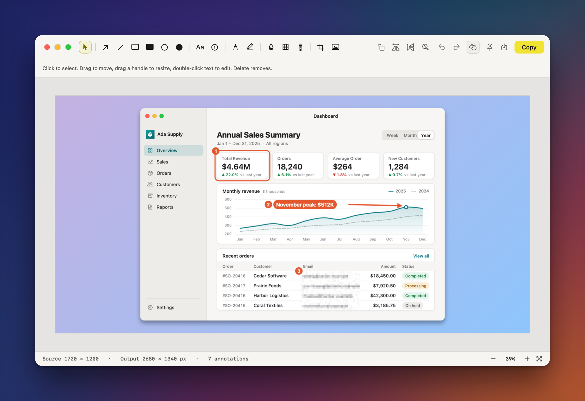
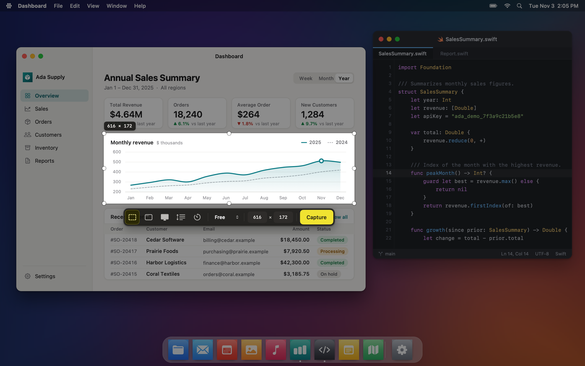
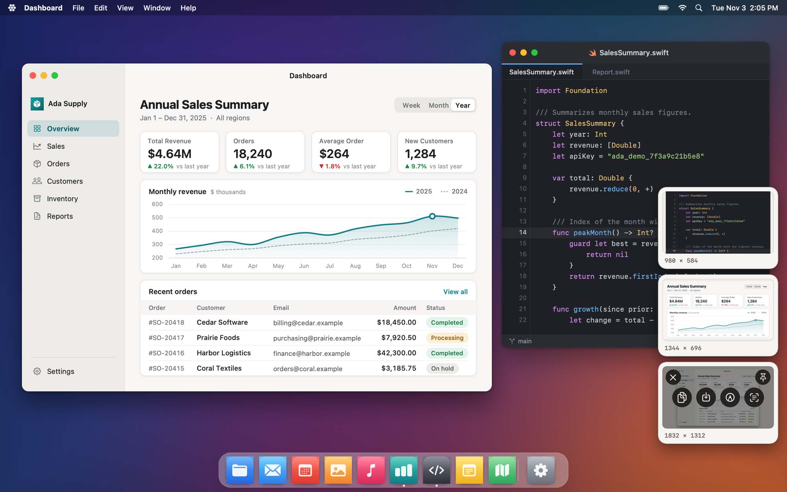
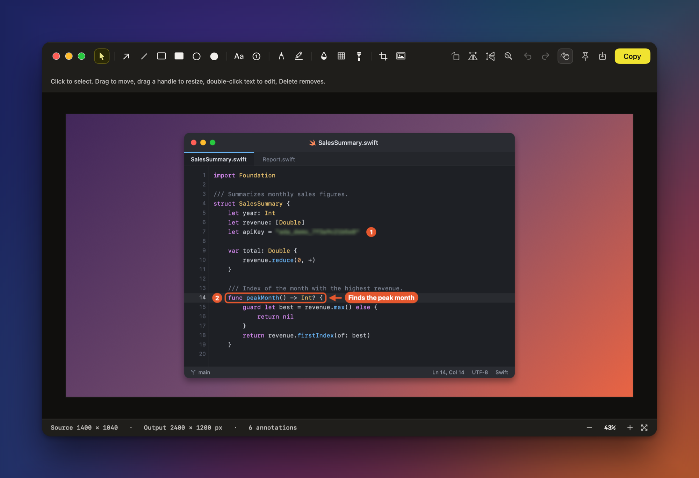
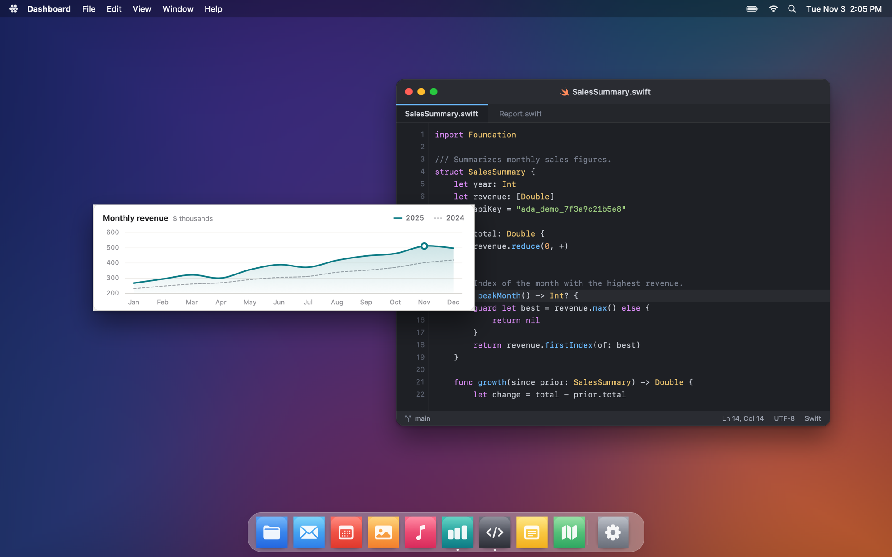
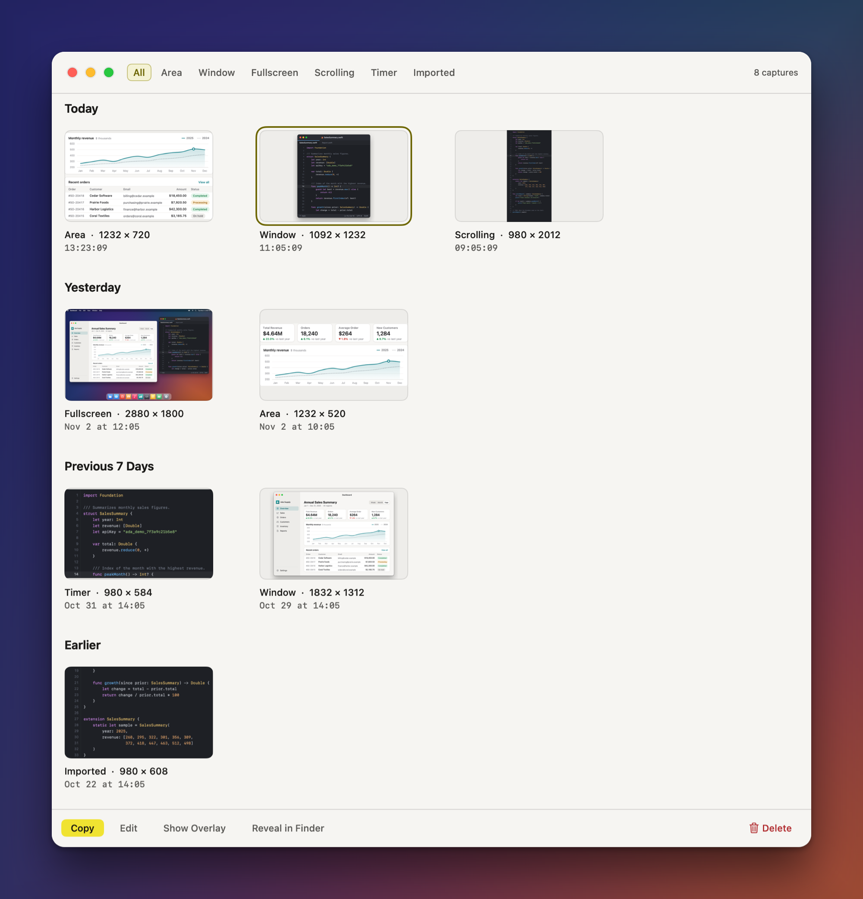
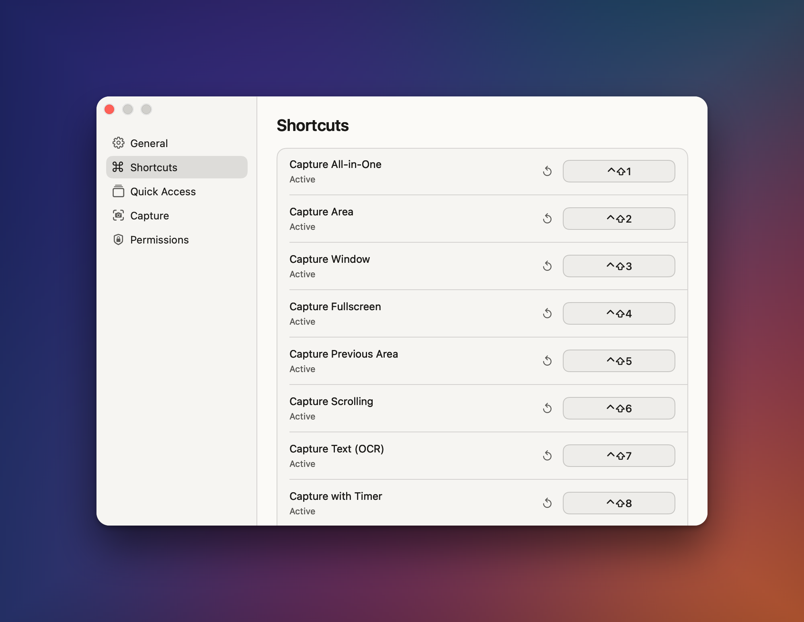

<p align="center">
  
</p>

<h1 align="center">Cornermark</h1>

<p align="center">
  A local screenshot app for the macOS menu bar.<br>
  Capture, annotate, copy. Nothing leaves your Mac.
</p>

<p align="center">
  
</p>

Cornermark is a personal screenshot tool for the macOS menu bar. It has no Dock icon, no account, and no cloud connection. You build it from source with Swift Package Manager, and it requires macOS 14 or later.

## What it does

### Capture an area, a window, or the full screen

`Ctrl+Shift+1` opens a single overlay. Drag to select an area, type an exact size, or lock an aspect ratio. The toolbar switches to window, full screen, scrolling, and timed capture.



### Keep results at hand with Quick Access

Each capture appears as a card in a corner of the screen. Hover a card to get Copy, Save, Edit, Pin, OCR, and Close buttons. Drag a card into another app to drop it as a PNG file. Cards never take focus from the app you are using.



### Mark up and redact in the editor

The editor has arrows, lines, rectangles, ellipses, text, numbered steps, a pen, and a highlighter. You can blur or pixelate sensitive areas, crop the image, and place it on a background. The editor follows the system light or dark appearance.



### Pin a screenshot above everything

A pinned screenshot becomes an always-on-top window that you can keep next to your work. Scroll or pinch to zoom, Option-scroll to change opacity, and use the arrow keys to move it by 1 point (10 with Shift). Lock mode passes clicks through to the window behind it.



### Find old captures in History

Cornermark writes every capture to History. You can filter by type, bring a capture back to Quick Access, or reopen it in the editor with your edits intact. By default, Cornermark deletes captures older than 30 days.

<p align="center">
  
</p>

### Read text and QR codes

Press `Ctrl+Shift+7` and select an area. Vision recognizes the text on your device, detects the language, and Cornermark copies the result to the clipboard with the line order intact. QR code contents are copied as text too.

## Build

```sh
scripts/build-app.sh            # debug build, creates build/Cornermark.app
scripts/build-app.sh --release  # release build
scripts/build-app.sh --no-sign  # skips signing
```

The script runs `swift build`, assembles `build/Cornermark.app`, and signs it. Move `build/Cornermark.app` to your Applications folder and open it.

### Sign with a stable certificate

macOS ties the Screen Recording permission to the app's code signature. An ad-hoc signature changes with every build, so macOS forgets the permission each time. The script therefore uses the first "Apple Development" certificate listed by `security find-identity -v -p codesigning`, selected by its SHA-1 hash. To use a different certificate:

```sh
CORNERMARK_SIGN_IDENTITY=<certificate-hash> scripts/build-app.sh
```

If no certificate exists, the script prints a warning and falls back to ad-hoc signing. To create a free Apple Development certificate, go to Xcode > Settings > Accounts > Manage Certificates. Cornermark does not use the hardened runtime, the sandbox, or notarization.

## Grant the Screen Recording permission

1. Open Cornermark and try a capture. If the permission is missing, Cornermark shows an explanation window.
2. Click **Open System Settings**. It opens Privacy & Security > Screen & System Audio Recording.
3. Turn on Cornermark in the list.
4. Quit and reopen Cornermark. macOS applies the permission only after a restart.

Settings > Permissions also shows the current state.

## Shortcuts

The defaults use `Ctrl+Shift+number` and do not conflict with system shortcuts. You can change them in Settings > Shortcuts, which shows a red warning if another app already uses a shortcut. Cornermark registers shortcuts with Carbon `RegisterEventHotKey`, so it does not need the Accessibility permission.

| Shortcut | Action |
| --- | --- |
| Ctrl+Shift+1 | All-in-one (area, window, full screen) |
| Ctrl+Shift+2 | Capture area |
| Ctrl+Shift+3 | Capture window |
| Ctrl+Shift+4 | Capture full screen |
| Ctrl+Shift+5 | Capture the previous area again |
| Ctrl+Shift+6 | Scrolling capture |
| Ctrl+Shift+7 | Capture text (OCR) |
| Ctrl+Shift+8 | Timed capture |

<p align="center">
  
</p>

## Details

- **After capture.** Cornermark can show a Quick Access card, copy to the clipboard, save to a folder (`Cornermark YYYY-MM-DD at HH.MM.SS.png`), or open the editor. Every capture also goes to History.
- **Quick Access.** Swipe a card toward the screen edge with two fingers to dismiss it, or double-click it to open the editor. The auto-dismiss timer is adjustable and pauses while the pointer is over the card. You can restore the last closed card and hide all cards temporarily.
- **Pins.** To unlock a locked pin, use the "Pinned Screenshots" list in the menu bar. Escape or the close button removes a pin.
- **History.** You can also copy a capture, reveal it in Finder, and delete it. Cornermark removes old captures at launch and once a day.
- **Settings.** Launch at login, save folder, PNG or JPEG, sound, shortcuts, card corner and size, window shadow, timer length, retention period, and permission state.
- **Open from Finder.** "Open With" opens PNG, JPEG, and HEIC files in the editor.
- **URL scheme.** `cornermark://capture-area`, `capture-window`, `capture-fullscreen`, `all-in-one`, `previous-area`, `scrolling`, `ocr`, `timer?seconds=5`, `history`, `settings`, `restore-overlay`, `hide-overlays`, `open?path=/full/path/image.png`. The `open` path must be an existing image file. Cornermark logs and ignores unknown paths.

## What it leaves out

- No cloud, accounts, or share links.
- No video or GIF recording.
- No prebuilt releases, App Store version, notarization, or automatic updates. You build and run it on your own Mac.

## Develop

```sh
swift build                                  # builds everything
swift test                                   # CornermarkCore tests
swift run HarnessShell                       # shell checks, opens no windows on screen
swift run HarnessReadme                      # regenerates docs/screenshots
swift scripts/make-icon.swift docs/logo.png  # regenerates the icon in this README
```

`HarnessShell` sets the activation policy to `.prohibited`, orders no windows, and takes no focus. It replaces the pasteboard, UserDefaults, and the history folder with temporary objects, and writes snapshots to `build/harness/shell/`.

`HarnessReadme` produces the images on this page. The windows and cards are the app's real interface. The desktop, menu bar, Dock, dashboard, and code window are drawn sample content, and the companies and figures are fictional.

## License

[MIT](LICENSE)
